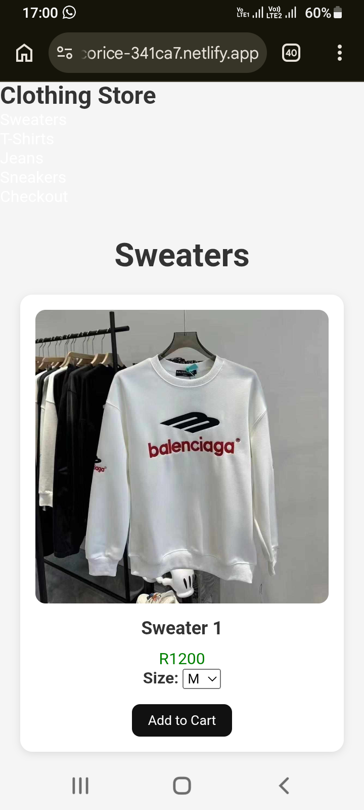
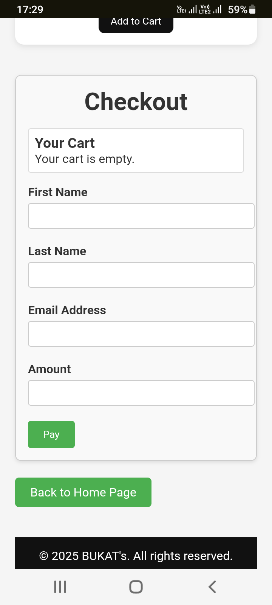
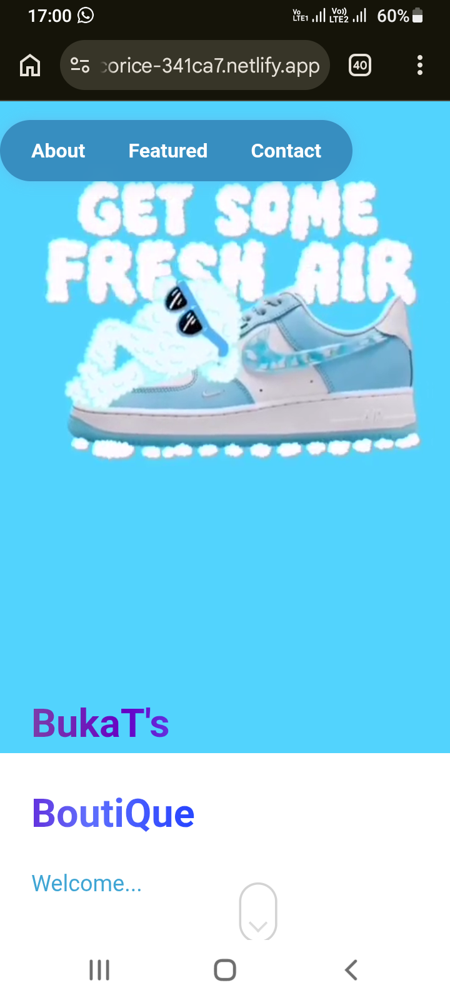

 A Generational Dream, Built Online

Bukatee is an online clothing store born from a dream. An elderly family member always wanted to open a clothing shop but never could — rent and overheads stood in the way, and he passed before seeing it happen. A younger relative picked the dream up and built it as a website: a clothing store without the rent, kept alive through tech.

The Problem
Far-away customers couldn't place orders

Many of Bukatee's customers live too far to visit in person. Without a website, they had no way to browse the clothing range, place an order, or pay — everything depended on phone calls and manual back-and-forth, and sales were lost along the way.

 How Bukatee Solves It

- Browse from anywhere — the website is the shop, open to customers regardless of distance.
- Order remotely — customers can go through the ordering flow without travelling.
- Pay securely via Paystack — remote customers can complete payment online, safely and without being physically present.

Distance no longer decides who can shop at Bukatee.

## Built So Far

- Paystack payment integration for real remote transactions
- Storefront foundation for browsing and ordering clothing

Coming Next

- Richer product catalogue
- Smoother checkout
- Customer accounts and order tracking
- Mobile-first design
- Admin tools and delivery options

 Why It Matters

A shop that once couldn't afford the rent now has a home online — and its customers aren't limited by distance. Bukatee is a generational dream being lived out loud, built one feature at a time.

)

Built to defeat the toll-gates, boarder and overrall there's no distance than stop you from getting your favorite outfit. It travels to you bought by you. We are solving the issues that customers face whether it's distance or exhaustion of physically going to purchase or even a busy schedule. How can we ease life for you the BukaTee's way!!!Reach out

